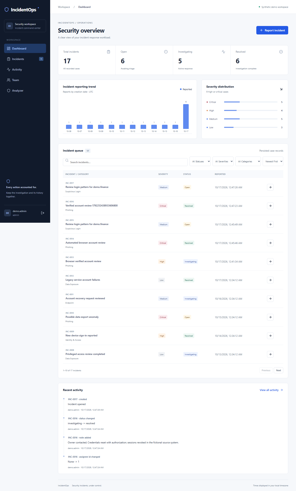
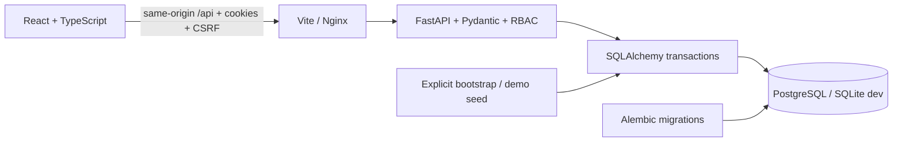

# IncidentOps

**Security incidents, under control.** A full-stack workspace for reporting, triage, investigation, and accountable resolution. Portfolio software using fictional demonstration data; not a live intrusion detector or an audited commercial SOC product.

## Implemented

- React/TypeScript dashboard with persisted status counts, severity distribution and clickable filters, reporting trend, recent cases and actor-attributed activity.
- Server-backed search, status/severity/category filters, sorting and bounded pagination. Case details with editable summary, status/severity, admin assignment, notes, resolution/reopening confirmation, chronological history.
- Argon2 passwords, opaque eight-hour server sessions, hashed tokens in the database, HttpOnly SameSite cookies, CSRF/origin checks, login throttling and backend Admin/Analyst/Viewer permissions. No credentials in browser storage.
- Admin user provisioning and member directory; analysts investigate, viewers read.
- Incremental Alembic migrations preserving starter incidents. SQLite development/tests and PostgreSQL container configuration.
- Authorized example CSV analysis: five failures in a rolling ten-minute window, success-after-failures indicator, validation and flag-to-incident workflow. A flag is not proof of intrusion.
- Backend and frontend interaction tests, Ruff, ESLint, TypeScript, production build, Dockerfiles and GitHub Actions configuration.



## Windows quick start

Install Python 3.11+ and Node.js 22.12+ including npm. Change to this repository in PowerShell, then:

```powershell
python -m venv .venv
.\.venv\Scripts\python.exe -m pip install -e '.[dev]'
.\scripts\dev.ps1 -Demo
```

Open **http://localhost:5173**. The explicit `-Demo` switch creates fictional cases and the demo account if absent. The launcher migrates, runs `npm ci`, starts the API hidden, and runs Vite in the foreground. Ctrl+C stops development services. Use localhost consistently; exact origin checks reject another hostname. If organizational PowerShell policy restricts scripts, use the manual commands below.

**Development demo:** `demo.admin` / `Demo-Only-Change-Me!`.

No demo account is seeded automatically on app startup, in Docker, or by migrations. `python -m incidentops.manage demo` refuses with `APP_ENV=production`. Never copy a demo database into production. Demo credentials exist in the development seed utility and documentation, never the client bundle.

### Manual Windows / macOS / Linux

Create a virtual environment first. macOS/Linux: `python3 -m venv .venv` and `source .venv/bin/activate`. Windows: `python -m venv .venv` and `.venv\Scripts\Activate.ps1`, or call `.venv\Scripts\python.exe` explicitly.

Terminal 1, repository root:

```sh
python -m pip install -e '.[dev]'
python -m alembic upgrade head
python -m incidentops.manage demo  # optional explicit fictional seed
python -m uvicorn incidentops.main:app --host 127.0.0.1 --port 8000
```

Terminal 2:

```sh
cd frontend
npm ci
npm run dev
```

For an unseeded workspace, replace the demo command with `python -m incidentops.manage admin --username your-admin`; enter a 12+ character password at the hidden prompt. OpenAPI: **http://127.0.0.1:8000/docs**. Use the UI or the Python API example for write flows: `/auth/login` sets cookies, and writes require the `csrf` value as `X-CSRF-Token`. The UI handles this automatically. Direct Swagger browser writes use a different origin and require matching `APP_ORIGIN`; changing it means the frontend origin is no longer accepted.

## Docker / PostgreSQL

Install Docker Desktop with Compose. At repository root:

```powershell
Copy-Item .env.example .env
# Edit .env: set a unique long URL-safe POSTGRES_PASSWORD.
docker compose up --build -d
# Optional development-only seed:
docker compose exec api python -m incidentops.manage demo
```

Open **http://localhost:8080**. Nginx serves the built client and proxies `/api/` under one origin. API/database ports stay private to Compose. PostgreSQL persists in `pg_data`. `docker compose down` preserves it; avoid `down -v` unless intentionally deleting data. Check `docker compose logs api` for migration diagnostics. For real accounts use `docker compose exec api python -m incidentops.manage admin --username your-admin` instead of the demo seed.

Docker was unavailable on this host: container builds and PostgreSQL runtime behavior remain unverified.

## Configuration

| Variable | Default / purpose |
|---|---|
| `DATABASE_URL` | `sqlite:///./incidentops.db`; use `postgresql+psycopg://...` for PostgreSQL |
| `APP_ENV` | Unset/development locally; exactly `production` enables Secure cookies and seed refusal |
| `APP_ORIGIN` | Native `http://localhost:5173`; Compose `http://localhost:8080`; production exact HTTPS origin |
| `POSTGRES_PASSWORD` | Required Compose password; URL-safe alphanumeric avoids URL escaping mistakes |

`.env` is ignored. Compose reads it; native commands use exported process environment. PowerShell: `$env:DATABASE_URL='...'`; POSIX: `export DATABASE_URL='...'`. Never place credentials in a `VITE_*` variable.

## Architecture



Starter incident/history endpoints remain; shared API keys were replaced by account sessions. Case mutations and audit events commit together; no-op updates do not duplicate events. History has no edit/delete API. Assignments reference users. All members share one workspace. See [security decisions](docs/SECURITY.md).

```text
incidentops/       API, models, auth, analyzer, bootstrap
migrations/        incremental Alembic revisions
tests/             workflow, role, migration, analyzer tests
frontend/src/      typed client, shell, forms, queue, investigation
scripts/dev.ps1    Windows launcher
docs/              walkthrough, security, verification
.github/workflows/ CI
```

## API

| Endpoints | Permission / behavior |
|---|---|
| `GET /health` | Public database connectivity check |
| `POST /auth/login`, `GET /auth/me`, `POST /auth/logout` | Sign in, current account, revoke session |
| `GET /incidents` | Read; q/status/severity/category/sort/limit/offset; `X-Total-Count` |
| `POST /incidents` | Analyst/admin create |
| `GET/PATCH /incidents/{id}` | Read / analyst/admin update; assignment admin-only |
| `GET /incidents/{id}/history` | Chronological audit records |
| `GET/POST /incidents/{id}/notes` | Read / analyst/admin add |
| `GET /metrics`, `GET /activity` | Aggregates / paginated recent events |
| `GET/POST /users` | Member directory / admin provisioning |
| `POST /analyzer` | Analyst/admin example CSV analysis; persists only on case creation |

See [API example](docs/API_EXAMPLE.md) and OpenAPI for contracts. Sort: newest/oldest/title; limit: 1–100. Errors: 401 missing/expired auth, 403 permission/CSRF/origin failure, 404 missing case, 409 duplicate username, 413 oversized write, 422 invalid input, 429 throttled login.

## Tests and CI

```sh
python -m pytest -q
python -m ruff check .
cd frontend
npm run typecheck
npm run lint
npm test
npm run build
npm audit
```

See [VERIFICATION.md](docs/VERIFICATION.md) for actual outcomes. No coverage or throughput claims are made. UI tests use mocked network responses; browser checks separately exercise the native stack. CI is prepared but has not run on GitHub here.

## Demo

Follow [the walkthrough](docs/DEMO_WALKTHROUGH.md). The sample CSV has twelve fictional rows with reserved documentation IPs. Analyze, inspect the rule, create a case, assign an analyst, add context, investigate, then resolve with a documented rationale. Never call a rule match confirmed compromise.

## Deployment preparation

Use HTTPS and managed PostgreSQL, with the client and `/api` on one public origin. Build both Dockerfiles. Configure provider secrets: `DATABASE_URL` with required TLS settings, `APP_ENV=production`, `APP_ORIGIN=https://your-host`. Run `python -m alembic upgrade head` as one release job before replicas start. Compose migrates at startup for local use. Configure Nginx `proxy_pass` for the private backend hostname if the host does not provide Compose networking. Bootstrap an admin through a private terminal; do not seed or upload the demo database.

Back up Postgres and test restoration. Separate migration/runtime DB roles and restrict ingress. Add shared edge throttling before multiple replicas. Health paths: internal `/health`, public proxy `/api/health`. Compose binds localhost and needs production ingress configuration. No cloud resources, paid services, pushes, or deployments were performed.

### Publish yourself

Create an empty GitHub repository. Inspect `.gitignore` and `git status` for secrets, databases and node_modules, then:

```sh
git init
git add .
git commit -m "Build IncidentOps full-stack incident workspace"
git branch -M main
git remote add origin YOUR_REPOSITORY_URL
git push -u origin main
```

Check Actions before deployment. Suggested description: “Security incident command center with React, FastAPI, role-based sessions, PostgreSQL, auditable investigations, and tested login-log analysis.”

## Troubleshooting / limitations

- Missing npm: install Node with npm and reopen the terminal. This host used a local npm CLI.
- Missing tables: run Alembic at repository root. For a pre-Alembic starter database, back it up, verify revision-0001 compatibility, then `python -m alembic stamp 0001` and `python -m alembic upgrade head`. Never stamp an unknown schema.
- Origin rejected: use documented localhost or set `APP_ORIGIN` exactly. Secure cookies require production HTTPS.
- No MFA, password recovery, deactivation UI, SSO or tenant isolation. Process-local login throttling needs shared deployment enforcement.
- Charts show the 14 most recent dates containing reports, without zero-filled dates; severity includes resolved cases. Details retain complete history.
- Data refreshes after local mutations; no WebSocket push. Edits use last-write-wins.
- Audit is immutable through the API, not tamper-evident against database administrators. Nginx supplies ingress body limits and CSP.

## Truthful resume bullets

- Built a React/TypeScript and FastAPI incident workspace with SQLAlchemy persistence, searchable paginated queues, analyst assignment, notes, and database-derived metrics.
- Implemented Argon2 passwords, hashed server-side sessions, cookie/CSRF controls, and backend role enforcement with automated authentication and workflow tests.
- Added incremental Alembic migrations and a validated CSV login-pattern analyzer; prepared PostgreSQL Docker Compose and GitHub Actions workflows and verified the native SQLite-backed app locally.
